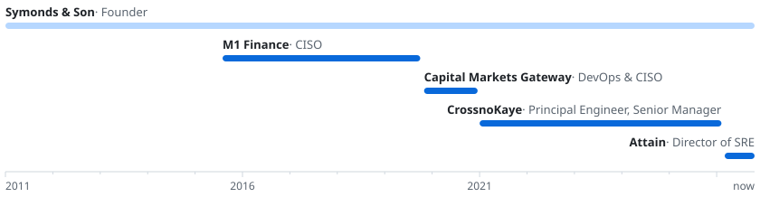

**Engineer building agent platforms, evaluation systems, and AI infrastructure.**

Fifteen years in infrastructure and security, from building M1 Finance's platform as employee #8 to running industrial edge fleets and multi-cluster Kubernetes. Since 2025 I build by directing coding agents. Most of my time goes to the specs, gates, and evals that decide what they ship, and to the platforms they run on.

[joshsymonds.com](https://joshsymonds.com) &nbsp;·&nbsp; [LinkedIn](https://www.linkedin.com/in/joshsymonds/) &nbsp;·&nbsp; [Email](mailto:josh@joshsymonds.com)

### Now

**Attain** &nbsp;Director of SRE, Consumer Product

- **Agent platform.** Built Marvin, Attain's company-wide agent platform in Slack. Agents run as ephemeral Kubernetes workers with per-user OAuth, Cedar policies on every tool, and versioned model routes with one-step rollback.
- **Evaluation.** A harness that replays production code reviews against candidate models, used to move review to open-weight models.
- **Incidents.** Automated first-pass investigation of production alerts, down to merge requests that fix the alerted bug.

### Selected work

**[Savecraft](https://savecraft.gg)** &nbsp;Go · TypeScript · WebAssembly · MCP 
An AI gaming companion that works from your real save files, across 14 games and in OpenAI's connector directory. Its model was chosen by a 13-model bake-off over 295 production scenarios, judged by a validated decider model. The local client is [open source](https://github.com/joshsymonds/savecraft-client).

**[Gambit](https://github.com/joshsymonds/gambit)** &nbsp;Claude Code · Pi 
A contract-to-release workflow for coding agents. Each task is judged done or not done against a written contract, with test evidence and no check-ins mid-run.

<picture>
  <source media="(max-width: 600px) and (prefers-color-scheme: dark)" srcset="assets/gambit-narrow-dark.svg">
  <source media="(max-width: 600px)" srcset="assets/gambit-narrow-light.svg">
  <source media="(prefers-color-scheme: dark)" srcset="assets/gambit-dark.svg">
  
</picture>

**[nix-config](https://github.com/joshsymonds/nix-config)** &nbsp;Nix · NixOS · home-manager 
Declarative configuration for my nine-host NixOS fleet.

**[Dynamoid](https://rubygems.org/gems/dynamoid)** &nbsp;Ruby · DynamoDB 
The Ruby ORM for Amazon DynamoDB. I'm the original author; it has over 13 million downloads.

### Earlier

<picture>
  <source media="(max-width: 600px) and (prefers-color-scheme: dark)" srcset="assets/timeline-narrow-dark.svg">
  <source media="(max-width: 600px)" srcset="assets/timeline-narrow-light.svg">
  <source media="(prefers-color-scheme: dark)" srcset="assets/timeline-dark.svg">
  
</picture>

**CrossnoKaye** &nbsp;2021–2026 
Principal Infrastructure Engineer, then Senior Manager of Core Services. Built the control plane, deploy tooling, and industrial IoT edge OS for 123 production deployments.

**Capital Markets Gateway** &nbsp;2019–2020 
DevOps Engineer and CISO. Multi-region Kubernetes, plus the NIST CSF and ISO 27001 programs.

**M1 Finance** &nbsp;2015–2019 
Chief Information Security Officer. Employee #8; built the infrastructure from launch to nearly $1B in assets.

**Symonds & Son** &nbsp;2011–present 
Founder of an independent infrastructure consultancy. Running LiveWorld's AWS platform and GPU inference infrastructure since 2013.

**University of Chicago** &nbsp;BA, East Asian Languages and Civilizations
